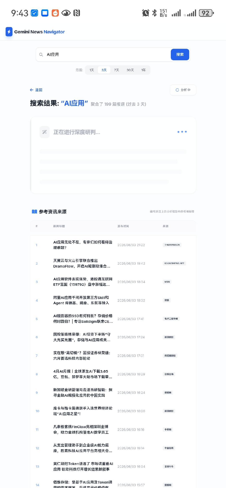
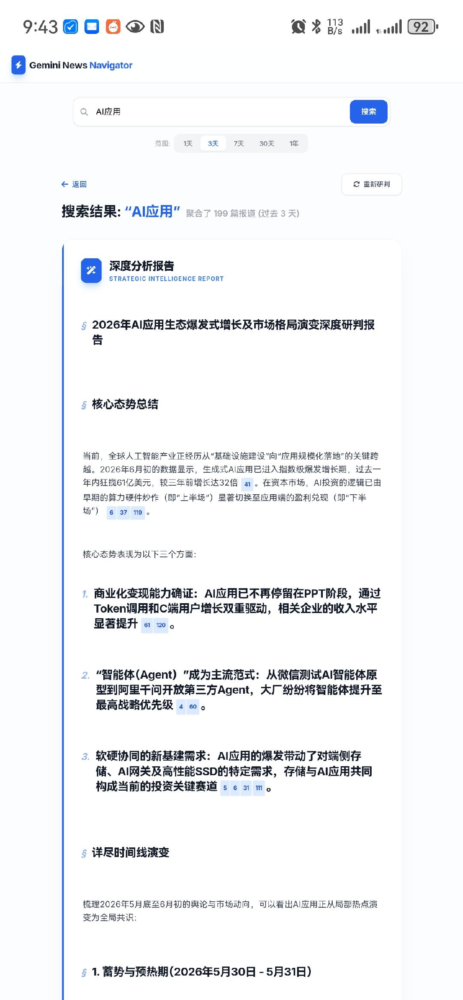

# 📰 Gemini News Navigator

> 一个**高性能**的 AI 驱动新闻聚合 + 智能分析 Web 应用。从 **Google News RSS** 抓取最新新闻，用 **Google Gemini** 生成**带引用溯源**的专业研报式综述。

   

## 📸 应用截图

### 搜索结果 + AI 深度研判

<div align="center">
  
</div>

> 搜索"AI应用" + 3 天范围 → 聚合 **199 篇报道** → 点击 AI 研判，引用列表实时显示在下方。

### 学术引用式 AI 研报

<div align="center">
  
</div>

> AI 生成专业研报，每条论断带新闻编号（如 `[41]`、`[6, 37, 119]`），点击可跳转到对应新闻。

---

## ✨ 特性

- 🔍 **灵活搜索**：支持 1 天 / 3 天 / 7 天 / 30 天 / 1 年 五个时间范围
- 📰 **新闻聚合**：从 Google News RSS 抓取，按时间排序，去重清洗
- 🤖 **AI 深度综述**：用 Gemini 3 Flash 生成**学术引用式**分析报告
- 📎 **引用溯源**：AI 输出的每条论断都标注**新闻来源编号** `[1] [2, 5]`，可点击跳转
- 📱 **响应式**：桌面端表格视图，移动端卡片视图
- 🛡️ **安全架构**：所有 API 调用走 Vercel Edge Function 代理，**API Key 不暴露前端**
- 🔧 **诊断面板**：内置 API 健康检查界面

---

## 🏗️ 架构

```
┌─────────────────────────────────────────┐
│  Frontend (React 19 + Vite 6)           │
│  ┌───────────┐ ┌───────────┐ ┌────────┐ │
│  │ SearchBox │ │NewsTable  │ │  Debug │ │
│  └───────────┘ └───────────┘ └────────┘ │
│         │           ▲             │      │
│  ┌──────▼──────────┴─────────────▼──┐  │
│  │   services/ (fetch wrapper)      │  │
│  └────────────┬──────────────┬───────┘  │
└───────────────┼──────────────┼─────────┘
                │              │
       /api/news (edge)   /api/gemini (edge)
                │              │
       Google News RSS    @google/genai
       (time segmented)   (gemini-3-flash)
```

---

## 🚀 Vercel 部署（推荐 ⭐ 5 分钟搞定）

> **你只需要一个 `GEMINI_API_KEY`**。前端和后端用同一份 Vercel 部署。

### 步骤 1：导入项目

1. 登录 [vercel.com](https://vercel.com)
2. **Add New → Project → Import** `wutao667/NewsFetch`
3. 同意 Vercel 访问你的 GitHub 仓库授权

> 💡 **如果想 fork 到自己账号再部署**：在 GitHub 上打开 https://github.com/wutao667/NewsFetch，点 **Fork**，然后在 Vercel 里选 fork 后的仓库即可。两种方式效果一样。

### 步骤 2：配置环境变量

在 Vercel 项目设置里：

1. 进入项目 → **Settings** → **Environment Variables**
2. 添加：
   | Name | Value |
   |------|-------|
   | `GEMINI_API_KEY` | `AIzaSy...` 你的 Gemini API Key |

> 💡 **获取 Gemini API Key**：访问 [aistudio.google.com/app/apikey](https://aistudio.google.com/app/apikey) 免费申请（Google 账号即可）

3. **Environment**：选 `Production`（或全部勾选）

### 步骤 3：部署

1. Vercel 会自动检测 Vite 项目
2. **Build Command**：`vite build`（自动识别）
3. **Output Directory**：`dist`（自动识别）
4. 点击 **Deploy** 🚀

约 1-2 分钟后部署完成，会得到一个 `xxx.vercel.app` 的地址。

### 步骤 4：验证

1. 打开你的 Vercel 域名
2. 搜索任意话题（例如"AI"）
3. 等待新闻列表 → 点击 **AI 总结** 按钮
4. 应该能看到带 `[1] [2, 3]` 引用的分析报告 ✅

如果失败：进入项目 → 顶部菜单的 **Diagnostics**，点"开始测试"看是哪个 API 出问题。

---

## 💻 本地开发

**前置**：Node.js 18+

```bash
# 1. 克隆
git clone https://github.com/wutao667/NewsFetch.git
cd NewsFetch

# 2. 安装依赖
npm install

# 3. 配置环境变量
echo "GEMINI_API_KEY=你的_key" > .env.local

# 4. 启动开发服务器
npm run dev
```

打开 http://localhost:3000

> **注意**：本地运行时，Vite 会把 `/api/*` 自动代理到 Vercel 路径，需要用 `vercel dev` 或者在 `vite.config.ts` 里加代理配置才能本地调用 Edge Function。

### 本地跑 Edge Function

```bash
# 安装 Vercel CLI
npm i -g vercel

# 本地跑（会读取 .env.local）
vercel dev
```

---

## 📁 项目结构

```
NewsFetch/
├── api/                          # Vercel Edge Functions
│   ├── news.ts                  # Google News RSS 抓取 + 时间分段
│   └── gemini.ts                # Gemini AI 综述生成
├── services/                    # 前端 API 封装
│   ├── newsService.ts
│   └── geminiService.ts
├── components/                  # React 组件
│   ├── SearchBox.tsx           # 搜索框 + 时间范围
│   ├── NewsTable.tsx           # 桌面/移动响应式列表
│   └── DebugView.tsx           # API 诊断面板
├── App.tsx                      # 主应用
├── index.tsx                    # 入口（含错误捕获）
├── index.html                   # HTML 模板（importmap）
├── types.ts                     # TypeScript 类型定义
├── vite.config.ts
├── tsconfig.json
└── package.json
```

---

## 🔑 关键实现

### 时间分段抓取（`api/news.ts`）

不是一次拉完 RSS，而是**按时间段切片并发**：

| 时间范围 | 分段数 | 每段天数 |
|---------|--------|---------|
| 1 天 | 1 | 1 |
| 3 天 | 2 | 2 |
| 7 天 | 2 | 4 |
| 30 天 | 3 | 10 |
| 1 年 | 6 | ~60 |

每段用 `after:YYYY-MM-DD before:YYYY-MM-DD` 精确定位，最后 `Promise.all` 合并 + `Set` 去重。

### 学术引用 Prompt（`api/gemini.ts`）

```typescript
const prompt = `
请针对"${topic}"话题，基于以下新闻数据进行深度综述。

新闻列表：
${newsContent}  // 已编号 [1] [2] [3]...

报告结构：
1. 核心态势总结
2. 详尽时间线演变
3. 多维度深度剖析
4. 不同声音与立场
5. 未来趋势预判

【引用规范】每条论断必须标注新闻编号，例如 [1] 或 [2, 5, 12]
`;
```

`systemInstruction` 强调"严谨溯源，像学术论文"。

---

## 🛠️ 技术栈

| 层 | 技术 |
|----|------|
| 前端框架 | React 19 |
| 构建工具 | Vite 6 |
| 语言 | TypeScript 5.8 |
| 样式 | Tailwind CSS（CDN）|
| 图标 | Font Awesome 6 |
| 后端 | Vercel Edge Functions（Web 标准 Fetch API）|
| AI | Google Gemini 3 Flash（`@google/genai` v1.34）|
| 数据源 | Google News RSS |

---

## ⚙️ 环境变量

| 变量 | 必填 | 说明 |
|------|------|------|
| `GEMINI_API_KEY` | ✅ 是 | Google Gemini API Key，部署到 Vercel 必须设置 |

本地开发可选放在 `.env.local`（已在 `.gitignore`）。

---

## 📜 License

MIT
